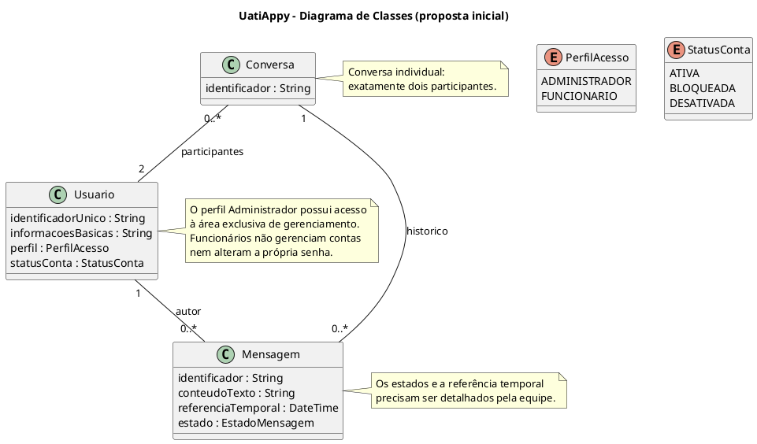
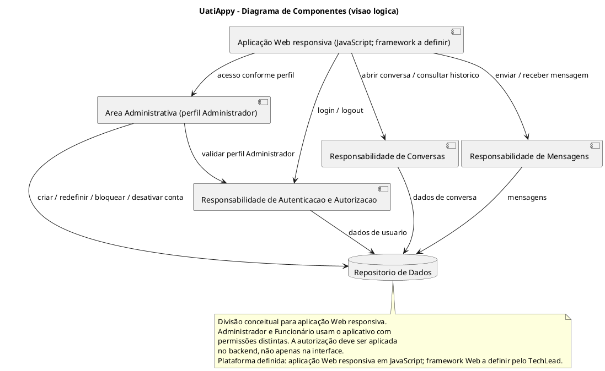
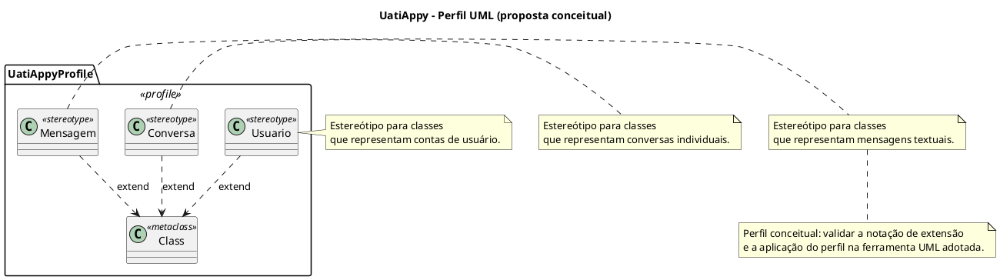
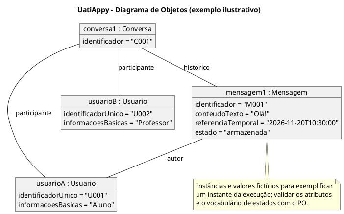
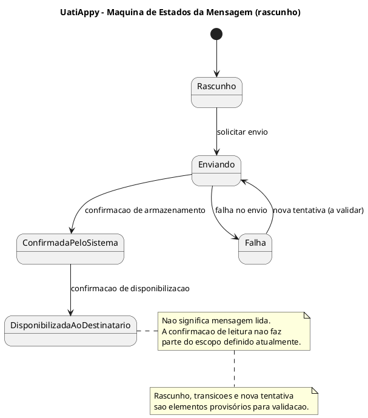
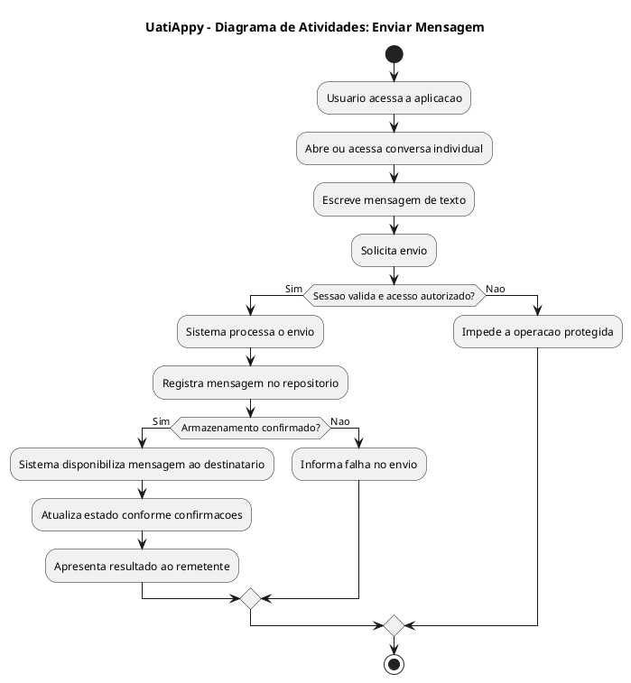
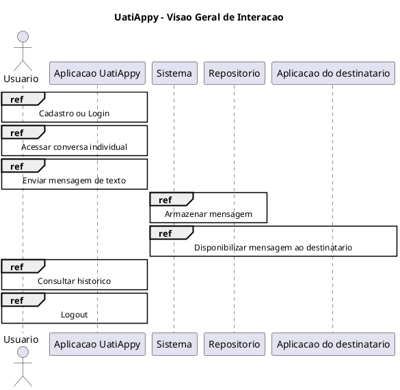

# Requisitos e escopo do MVP — UatiAppy

> **Atualização de plataforma — 25/11/2026:** o UatiAppy será uma única aplicação Web responsiva, acessível por um link no navegador em celulares e computadores. Não será aplicativo nativo nem PWA e não exigirá instalação. JavaScript, VS Code, Supabase/PostgreSQL, Vercel, GitHub e GitHub Actions estão definidos. O framework de interface Web permanece pendente de decisão do TechLead. Referências anteriores a React Native/Expo ou distribuição mobile neste documento foram substituídas por esta direção Web.

> **Status:** versão inicial para revisão da equipe e validação do orientador.  
> **Branch de documentação:** `docs/requisitos-escopo-mvp`.  
> **Objetivo:** manter uma referência única para os requisitos funcionais, requisitos não funcionais, regras de negócio e limites do MVP.

## 1. Visão geral

O UatiAppy é um projeto acadêmico de aplicação Web responsiva para comunicação institucional. O sistema será acessado por um único link no navegador, em celulares e computadores. O objetivo do MVP é demonstrar a troca de mensagens de texto entre dois usuários, com autenticação, persistência, histórico e controle de acesso.

Este documento consolida o escopo conhecido até o momento. Decisões ainda não confirmadas estão identificadas como **pendências de validação** e não devem ser tratadas como requisitos aprovados.

## 2. Requisitos funcionais (RF)

Requisitos funcionais descrevem os serviços e comportamentos que o sistema deve oferecer.

| ID | Requisito | Prioridade | Escopo |
|---|---|---|---|
| RF-001 | O sistema deve permitir que um usuário com perfil Administrador cadastre contas de funcionários. | Alta | MVP |
| RF-002 | O sistema deve permitir que funcionários com contas ativas realizem login com as credenciais fornecidas pela administração. | Alta | MVP |
| RF-003 | O sistema deve permitir visualizar informações básicas do próprio perfil e identificar os participantes de uma conversa. | Alta | MVP |
| RF-004 | O sistema deve permitir iniciar ou acessar uma conversa individual entre dois usuários. | Alta | MVP |
| RF-005 | O sistema deve permitir enviar mensagens de texto em uma conversa individual. | Alta | MVP |
| RF-006 | O sistema deve permitir receber mensagens de texto enviadas pelo outro participante. | Alta | MVP |
| RF-007 | O sistema deve armazenar as mensagens associadas ao autor e à conversa correspondente. | Alta | MVP |
| RF-008 | O sistema deve permitir consultar o histórico de mensagens de uma conversa autorizada. | Alta | MVP |
| RF-009 | O sistema deve apresentar as mensagens em ordem cronológica. | Alta | MVP |
| RF-010 | O sistema deve apresentar o estado de envio/recebimento/entrega da mensagem, conforme as confirmações suportadas pela aplicação. | Alta | MVP |
| RF-011 | O sistema deve informar quando ocorrer falha no envio de uma mensagem. | Alta | MVP |
| RF-012 | O sistema deve permitir encerrar a sessão do usuário (logout). | Média | MVP |
| RF-013 | O sistema deve disponibilizar uma área administrativa exclusiva para usuários com perfil Administrador. | Alta | MVP |
| RF-014 | O sistema deve permitir que o Administrador defina a senha inicial e redefina a senha de funcionários. | Alta | MVP |
| RF-015 | O sistema deve permitir que o Administrador bloqueie ou desative contas de funcionários. | Alta | MVP |

### 2.1 Observações sobre os RFs

- O RF-001 não representa cadastro público: a criação das contas é restrita ao perfil Administrador.
- O RF-002 aplica-se a contas ativas. Contas bloqueadas ou desativadas não devem conseguir autenticar-se.
- Os RF-013 a RF-015 descrevem operações administrativas; não implicam que já exista uma interface ou integração implementada.
- A administração define a senha inicial, entrega as credenciais ao funcionário e também define uma nova senha quando solicitada. O funcionário não realiza cadastro, alteração ou redefinição de senha por conta própria.
- O RF-003 cobre apenas identificação e informações básicas necessárias à comunicação. Edição avançada de perfil e foto não estão assumidas como parte do MVP.
- No RF-010, a equipe deve definir precisamente o significado de cada estado (por exemplo, enviado ao servidor, recebido pelo dispositivo destinatário e entregue à conversa). Não presumir confirmação de leitura: ela não está definida no escopo atual.
- O envio e recebimento em tempo real é uma expectativa de experiência do produto, mas a tecnologia e o mecanismo de atualização ainda dependem da decisão arquitetural.

## 3. Requisitos não funcionais (RNF)

Requisitos não funcionais estabelecem atributos de qualidade e restrições de operação.

| ID | Categoria | Requisito | Como validar / pendência |
|---|---|---|---|
| RNF-001 | Usabilidade | A interface deve ser simples, consistente e compreensível para os fluxos essenciais. | Realizar avaliação de usabilidade nos fluxos de cadastro, login, abertura de conversa e envio de mensagem. Definir roteiro e participantes. |
| RNF-002 | Desempenho | O envio e a atualização das mensagens devem ocorrer sem demora excessiva para o contexto de uso. | Definir ambiente de teste, carga e metas de tempo com a equipe; registrar medições. |
| RNF-003 | Segurança | Funcionalidades e dados restritos devem exigir autenticação válida. | Testar acesso autenticado e tentativas de acesso sem sessão. |
| RNF-004 | Privacidade e autorização | Cada usuário deve acessar somente conversas das quais participa. | Testar acesso cruzado entre contas e conversas não autorizadas. |
| RNF-005 | Confiabilidade | Mensagens confirmadas como armazenadas devem permanecer disponíveis após encerrar e iniciar uma nova sessão. | Enviar, encerrar sessão, autenticar novamente e verificar a recuperação do histórico. |
| RNF-006 | Compatibilidade Web responsiva | A aplicação deve funcionar em navegadores acordados pela equipe, em celulares e computadores, adaptando sua interface a diferentes larguras de tela. | A equipe deve registrar os navegadores, versões e tamanhos de viewport usados nos testes antes da validação. |
| RNF-007 | Integridade | O sistema deve preservar conteúdo, autoria e associação da mensagem à conversa. | Verificar dados após envio, recuperação e atualização do histórico. |
| RNF-008 | Manutenibilidade | O código deve ser organizado em componentes/módulos com responsabilidades claras e convenções documentadas. | Revisar estrutura, padrões de código e legibilidade em pull requests. |
| RNF-009 | Consistência de estado | O estado apresentado para uma mensagem deve refletir as confirmações efetivamente recebidas pelo sistema. | Testar sucesso, atraso, falha e reconexão; documentar transições permitidas. |
| RNF-010 | Proteção de credenciais | Credenciais não devem ser armazenadas ou transmitidas de forma desprotegida. | Revisar implementação de autenticação, armazenamento de senhas e configuração de transporte seguro. |
| RNF-011 | Autorização por perfil | Operações administrativas devem ser acessíveis somente a contas com perfil Administrador; funcionários devem acessar apenas as funcionalidades autorizadas ao seu perfil. | Testar tentativas de acesso direto às rotas e operações administrativas com conta de funcionário e sem autenticação. |
| RNF-012 | Estado da conta | Contas bloqueadas ou desativadas não devem autenticar-se nem acessar funcionalidades protegidas. | Testar login e sessões existentes após bloqueio/desativação; definir o comportamento de revogação de sessões. |

**Importante:** os RNFs acima são requisitos qualitativos iniciais. Não foram atribuídos números arbitrários (como tempo máximo de resposta ou percentual de disponibilidade). A equipe e o orientador devem definir metas mensuráveis, ambiente e método de medição antes de considerar esses requisitos totalmente verificáveis.

## 4. Regras de negócio (RN)

As regras de negócio definem restrições que devem ser respeitadas pelo sistema.

| ID | Regra |
|---|---|
| RN-001 | Cada usuário deve possuir uma conta identificável de forma única. |
| RN-002 | Somente usuários autenticados podem acessar funcionalidades e dados restritos. |
| RN-003 | Uma conversa individual deve possuir exatamente dois participantes. |
| RN-004 | Toda mensagem deve estar associada a um autor autenticado e a uma conversa existente. |
| RN-005 | Somente os participantes da conversa podem consultar suas mensagens. |
| RN-006 | As mensagens devem ser apresentadas em ordem cronológica, respeitando a referência temporal definida pelo sistema. |
| RN-007 | O estado de uma mensagem deve ser atualizado somente quando houver a confirmação correspondente no fluxo de comunicação. |
| RN-008 | Somente usuários com perfil Administrador podem criar, gerenciar, bloquear ou desativar contas de funcionários. |
| RN-009 | O cadastro de funcionários é centralizado na administração; não existe autocadastro de funcionários. |
| RN-010 | A administração define a senha inicial e fornece as credenciais ao funcionário por um meio apropriado e seguro. |
| RN-011 | A redefinição de senha é realizada pela administração, que define e fornece uma nova senha ao funcionário após solicitação. |
| RN-012 | Funcionários não podem alterar nem redefinir a própria senha pelo sistema. |
| RN-013 | Contas bloqueadas ou desativadas não podem realizar login nem acessar funcionalidades protegidas. |
| RN-014 | A área de gerenciamento de contas é exclusiva para usuários autenticados com perfil Administrador. |

## 5. Escopo do MVP

O MVP (Produto Mínimo Viável) contempla o conjunto mínimo de funcionalidades necessário para demonstrar a finalidade principal do UatiAppy: comunicação textual individual entre usuários.

### 5.1 Dentro do MVP

- Cadastro administrativo de contas de funcionários.
- Área administrativa exclusiva para gerenciamento de contas.
- Definição de senha inicial e redefinição administrativa de senha.
- Bloqueio e desativação de contas pela administração.
- Login e logout de funcionários com contas ativas.
- Autorização de funcionalidades conforme o perfil (Administrador ou Funcionário).
- Identificação básica dos participantes.
- Criação ou acesso a conversas individuais entre dois usuários.
- Envio e recebimento de mensagens de texto.
- Armazenamento e recuperação das mensagens.
- Consulta ao histórico da conversa.
- Exibição cronológica das mensagens.
- Indicação dos estados de envio/recebimento/entrega definidos pela equipe.
- Tratamento e comunicação de falhas no envio.
- Controle de acesso às conversas e proteção dos dados.

### 5.2 Fora do MVP — possibilidades futuras

Os itens abaixo não devem ser considerados tarefas obrigatórias da primeira entrega, salvo aprovação explícita de mudança de escopo:

- Conversas em grupo.
- Envio de imagens, vídeos, documentos e outros anexos.
- Edição ou exclusão de mensagens.
- Notificações push.
- Confirmação de leitura, caso não seja aprovada como parte do escopo.
- Recursos avançados de perfil, presença ou personalização.

## 6. Fluxo principal resumido

1. A administração acessa a área administrativa autenticada.
2. A administração cadastra o funcionário, define a senha inicial e fornece as credenciais.
3. O funcionário autentica-se com a conta ativa recebida.
4. O funcionário localiza ou acessa o outro participante e abre uma conversa individual.
5. O funcionário escreve e envia uma mensagem de texto.
6. O sistema valida a sessão e a autorização, registra a mensagem e associa o conteúdo ao autor e à conversa.
7. O sistema disponibiliza a mensagem ao outro participante e atualiza o estado conforme as confirmações recebidas.
8. Os participantes consultam o histórico em ordem cronológica.
9. Se o funcionário perder a senha, solicita à administração uma redefinição; a administração define e fornece uma nova senha.
10. A administração pode bloquear ou desativar uma conta; contas nesses estados não podem acessar o sistema.
11. Se ocorrer falha no envio, o sistema informa o remetente sem indicar sucesso indevidamente.

## 7. Critérios gerais de aceite do MVP

O MVP poderá ser considerado funcional quando, no mínimo:

- Um Administrador conseguir acessar a área administrativa e cadastrar uma conta de funcionário.
- A administração conseguir definir e fornecer a senha inicial e redefinir a senha de um funcionário.
- Um funcionário com conta ativa conseguir autenticar-se com as credenciais fornecidas.
- Não existir fluxo de autocadastro nem de alteração/redefinição de senha pelo funcionário.
- A administração conseguir bloquear ou desativar uma conta.
- Contas bloqueadas ou desativadas não conseguirem autenticar-se nem acessar funcionalidades protegidas.
- Uma conta de funcionário não conseguir acessar a área ou as operações administrativas.
- Dois funcionários distintos conseguirem autenticar-se.
- Uma mensagem de texto enviada for associada ao autor e à conversa correta.
- O destinatário conseguir receber e consultar a mensagem.
- O histórico permanecer disponível após nova autenticação.
- A ordem cronológica for mantida.
- O estado da mensagem representar as confirmações realmente recebidas.
- Uma falha de envio for apresentada ao remetente.
- Um usuário não conseguir acessar conversas das quais não participa.
- O logout encerrar o acesso às funcionalidades protegidas.

Os critérios devem ser detalhados em cenários de teste pelo responsável de SQA, em conjunto com PO e equipe técnica.

## 8. Rastreabilidade e gestão das Issues

As Issues do GitHub devem referenciar os IDs deste documento sempre que representarem trabalho relacionado a um requisito.

Sugestão de rastreabilidade inicial:

| Área de trabalho | Requisitos relacionados |
|---|---|
| Gerenciamento administrativo de contas | RF-001, RF-002, RF-013, RF-014, RF-015, RNF-003, RNF-010, RNF-011, RNF-012, RN-001, RN-008 a RN-014 |
| Login e logout | RF-002, RF-012, RNF-003, RNF-010, RNF-012, RN-001, RN-002, RN-013 |
| Perfil e identificação | RF-003 |
| Conversas individuais e autorização | RF-004, RNF-004, RN-003, RN-005 |
| Envio e recebimento de mensagens | RF-005, RF-006, RF-011, RNF-002, RNF-009, RN-004, RN-007 |
| Persistência e histórico | RF-007, RF-008, RF-009, RNF-005, RNF-007, RN-006 |
| Testes e validação | Todos os requisitos aplicáveis, especialmente RNF-001 a RNF-012 |

Antes de iniciar uma implementação, a equipe deve conferir se já existe uma Issue equivalente. Itens fora do MVP devem permanecer identificados como futuros ou ser encerrados como não planejados para esta entrega, sem apagar o histórico.

## 9. Pendências para validação da equipe e do orientador

- Confirmar os campos obrigatórios e a identificação única usada no cadastro de funcionários.
- Definir como a administração será provisionada inicialmente e como será protegido o primeiro acesso administrativo.
- Definir o meio seguro de entrega das credenciais e o procedimento operacional de redefinição de senha.
- Definir se o bloqueio é temporário, quais ações o revertem e como a desativação difere operacionalmente do bloqueio.
- Definir se a administração poderá reativar contas desativadas e como sessões ativas serão encerradas após bloqueio/desativação.
- Definir quais informações compõem o perfil básico.
- Definir como o usuário localizará o outro participante.
- Confirmar o significado e as transições dos estados da mensagem.
- Decidir se a entrega em tempo real é requisito obrigatório e qual mecanismo será adotado.
- A plataforma definida é uma aplicação Web responsiva, acessada por um único link em celulares e computadores. JavaScript, VS Code, Supabase/PostgreSQL, Vercel, GitHub e GitHub Actions estão definidos. O framework de interface Web ainda deve ser escolhido e registrado pelo TechLead. Registrar eventual validação formal do orientador, se exigida pelo processo acadêmico.
- Definir as versões de Android/iOS e os dispositivos móveis suportados.
- Confirmar a estratégia de builds, testes em dispositivos e distribuição do aplicativo.
- Confirmar quais serviços Supabase serão utilizados (Auth, PostgreSQL, Realtime, RLS e demais recursos), conforme os requisitos.
- Estabelecer metas mensuráveis para desempenho e demais RNFs que exigirem quantificação.
- Confirmar se todos os itens listados no MVP são compatíveis com o prazo e as orientações acadêmicas.

## 10. Diagramas UML

Esta seção reúne a seleção de diagramas definida pela equipe para documentar o UatiAppy. Os códigos-fonte abaixo são representações iniciais editáveis e devem ser revisados pelo TechLead, PO, equipe e orientador antes de serem considerados modelos aprovados.

**Convenções importantes:**
- Os diagramas devem representar somente o escopo funcional atualmente descrito neste documento.
- Elementos arquiteturais são conceituais enquanto serviços Supabase, componentes concretos e infraestrutura de hospedagem Web não forem validados.
- Estados e confirmações de mensagem ainda dependem de validação; não interpretar os exemplos como confirmação de leitura.
- Os blocos PlantUML são fontes editáveis. Para visualizar os desenhos, é necessário renderizá-los com uma ferramenta compatível com PlantUML.

### 10.1 Diagramas estruturais

A equipe definiu cinco diagramas estruturais: Classes, Componentes, Perfis, Objetos e Implantação.

#### 10.1.1 Diagrama de Classes

**Objetivo:** representar as principais entidades do domínio e seus relacionamentos. A proposta abaixo contém apenas Usuário, Conversa e Mensagem, compatíveis com os requisitos atuais.

**Rastreabilidade:** RF-001 a RF-009 e RF-013 a RF-015; RN-001 e RN-003 a RN-014; RNF-004, RNF-007, RNF-011 e RNF-012.



#### 10.1.2 Diagrama de Componentes

**Objetivo:** apresentar uma divisão lógica inicial de responsabilidades. Os componentes são agrupamentos conceituais, não tecnologias ou serviços já escolhidos.

**Rastreabilidade:** RF-001 a RF-015; RNF-003, RNF-004, RNF-006, RNF-008, RNF-010, RNF-011 e RNF-012.



#### 10.1.3 Diagrama de Perfis

**Objetivo:** registrar uma proposta de perfil UML do domínio, com estereótipos conceituais para os elementos centrais. A aplicação efetiva do perfil e sua extensão às metaclasses UML devem ser revisadas antes da versão final.

**Rastreabilidade:** RF-003 a RF-009; RN-001, RN-003 e RN-004.



#### 10.1.4 Diagrama de Objetos

**Objetivo:** mostrar um exemplo de instâncias em um momento da execução. Os nomes são ilustrativos e não representam dados reais.

**Rastreabilidade:** RF-004 a RF-009; RN-003, RN-004 e RN-006.



#### 10.1.5 Diagrama de Implantação

**Objetivo:** representar os nós lógicos dos navegadores em celulares e computadores, da hospedagem Web, do backend e da persistência. A aplicação Web usa JavaScript; o framework de interface e a configuração final dos serviços Supabase ainda dependem de definição.

**Rastreabilidade:** RNF-002, RNF-003, RNF-005, RNF-006 e RNF-010.

```plantuml
@startuml
title UatiAppy - Diagrama de Implantacao Web responsiva

node "Navegador em celular" as MOBILE {
  artifact "UatiAppy Web responsiva" as MOBILEAPP
}
node "Navegador em computador" as DESKTOP {
  artifact "UatiAppy Web responsiva" as DESKTOPAPP
}
node "Hospedagem Web — Vercel" as HOST {
  artifact "Aplicacao Web publicada\nJavaScript; framework a definir" as WEBAPP
}
cloud "Backend — Supabase" as BACKEND {
  component "Servicos/API" as API
  component "Autenticacao (se adotada)" as AUTH
  database "PostgreSQL" as DB
  component "Servico administrativo seguro\na definir no servidor" as ADMIN
}

MOBILEAPP --> WEBAPP : HTTPS / mesmo endereco
DESKTOPAPP --> WEBAPP : HTTPS / mesmo endereco
WEBAPP --> API : SDK/API — HTTPS
API --> AUTH : autenticacao (se adotada)
API --> DB : leitura e gravacao autorizadas
ADMIN --> API : operacoes privilegiadas no servidor

cloud "GitHub" as GITHUB
cloud "GitHub Actions" as ACTIONS
GITHUB --> ACTIONS : eventos do repositorio
ACTIONS --> HOST : verificacoes e deploy configurados

note bottom
  Um unico sistema Web responsivo para celular e computador.
  Nao e aplicativo nativo nem PWA; nao exige instalacao.
  JavaScript, Supabase/PostgreSQL, Vercel, GitHub e
  GitHub Actions estao definidos. Framework Web e recursos
  Supabase especificos ainda serao formalizados.
  Segredos e chaves privilegiadas nunca ficam no navegador.
end note
@enduml
```plantuml
@startuml
left to right direction
title UatiAppy - Diagrama de Casos de Uso

actor Funcionario
actor Administrador

rectangle UatiAppy {
  usecase "Realizar login" as UC2
  usecase "Gerenciar contas de funcionarios" as UCA1
  usecase "Cadastrar funcionario" as UCA2
  usecase "Definir senha inicial" as UCA3
  usecase "Redefinir senha" as UCA4
  usecase "Bloquear conta" as UCA5
  usecase "Desativar conta" as UCA6
  usecase "Visualizar perfil basico" as UC3
  usecase "Iniciar ou acessar
conversa individual" as UC4
  usecase "Enviar mensagem
de texto" as UC5
  usecase "Receber mensagem
de texto" as UC6
  usecase "Consultar historico" as UC7
  usecase "Consultar estado
da mensagem" as UC8
  usecase "Visualizar falha
de envio" as UC9
  usecase "Realizar logout" as UC10
}

Funcionario -- UC2
Funcionario -- UC3
Funcionario -- UC4
Funcionario -- UC5
Funcionario -- UC6
Funcionario -- UC7
Funcionario -- UC8
Funcionario -- UC9
Funcionario -- UC10
Administrador -- UC2
Administrador -- UCA1
Administrador -- UCA2
Administrador -- UCA3
Administrador -- UCA4
Administrador -- UCA5
Administrador -- UCA6
UCA1 .> UCA2 : <<include>>
UCA1 .> UCA3 : <<include>>
@enduml
```

#### 10.2.2 Diagrama de Máquina de Estados

**Objetivo:** ilustrar, de forma provisória, o ciclo de envio de uma mensagem. Os nomes e as transições precisam ser confirmados pelo PO e pela equipe, em especial o significado de “enviada”, “armazenada” e “entregue”.

**Rastreabilidade:** RF-005 a RF-007, RF-010 e RF-011; RN-004 e RN-007; RNF-009.



#### 10.2.3 Diagrama de Comunicação

**Objetivo:** demonstrar a colaboração entre a aplicação do remetente, a lógica do sistema, o repositório e a aplicação do destinatário durante o envio de uma mensagem.

**Rastreabilidade:** RF-005 a RF-007, RF-010 e RF-011; RN-002, RN-004, RN-005 e RN-007; RNF-003, RNF-004, RNF-005 e RNF-009.

```plantuml
@startuml
title UatiAppy - Diagrama de Comunicacao

object "App do remetente" as Remetente
object "Servidor" as Servidor
database "Repositorio" as Repositorio
object "App do destinatario" as Destinatario

Remetente -> Servidor : 1: enviarMensagem(conteudo, conversa)
Servidor -> Servidor : 1.1: validar sessao e autorizacao
Servidor -> Repositorio : 2: salvar mensagem
Repositorio --> Servidor : 2.1: confirmar armazenamento
Servidor --> Remetente : 3: informar resultado do envio
Servidor -> Destinatario : 4: [destinatario online] disponibilizar mensagem
Destinatario --> Servidor : 4.1: confirmar recebimento (a definir)

note bottom
  Os objetos e as ligações representam os participantes
  da colaboração. A condição entre colchetes é uma
  guarda da mensagem; não representa confirmação de leitura.
  O significado de recebimento/entrega ainda deve ser validado.
end note
@enduml
```

#### 10.2.4 Diagrama de Atividades

**Objetivo:** representar o fluxo de envio de uma mensagem, incluindo o caminho de falha sem afirmar critérios de validação ainda não especificados.

**Rastreabilidade:** RF-002, RF-004, RF-005, RF-007, RF-010 e RF-011; RN-002, RN-004 e RN-007; RNF-003 e RNF-009.



#### 10.2.5 Diagrama de Visão Geral de Interação

**Objetivo:** oferecer uma visão resumida das interações principais do MVP, conectando autenticação, acesso à conversa, envio, persistência, recebimento e consulta ao histórico.

**Rastreabilidade:** RF-001 a RF-012, conforme os fluxos representados; RN-001 a RN-007.



### 10.3 Matriz de rastreabilidade dos diagramas

| Diagrama | Requisitos e regras relacionados |
|---|---|
| Classes | RF-003 a RF-009; RN-001, RN-003 a RN-007; RNF-004 e RNF-007 |
| Componentes | RF-001 a RF-012; RNF-003, RNF-004, RNF-008 e RNF-010 |
| Perfis | RF-003 a RF-009; RN-001, RN-003 e RN-004 |
| Objetos | RF-004 a RF-009; RN-003, RN-004 e RN-006 |
| Implantação | RNF-002, RNF-003, RNF-005, RNF-006, RNF-010, RNF-011 e RNF-012; RN-008 a RN-014 |
| Casos de Uso | RF-001 a RF-015; RN-001 a RN-014; RNF-011 e RNF-012 |
| Máquina de Estados | RF-005 a RF-007, RF-010 e RF-011; RN-004 e RN-007; RNF-009 |
| Comunicação | RF-005 a RF-007, RF-010 e RF-011; RN-002, RN-004, RN-005 e RN-007 |
| Atividades | RF-002, RF-004, RF-005, RF-007, RF-010 e RF-011; RN-002, RN-004 e RN-007 |
| Visão Geral de Interação | RF-002, RF-004 a RF-012; RN-002 a RN-007 |

### 10.4 Pendências específicas dos diagramas

- Validar com o PO os atores Administrador e Funcionário e os limites de acesso de cada perfil.
- Confirmar o modelo de domínio, atributos e multiplicidades do diagrama de classes.
- Revisar a divisão lógica de componentes com base na arquitetura que a equipe vier a escolher.
- Validar a sintaxe e a aplicação do perfil UML, incluindo estereótipos e metaclasses estendidas.
- Substituir os valores ilustrativos do diagrama de objetos por um cenário acadêmico aprovado, sem usar dados pessoais reais.
- Atualizar o diagrama de implantação conforme forem definidos os serviços Supabase, ambientes, framework Web, navegadores suportados e fluxo de deploy; a visão atual permanece conceitual.
- Definir os estados oficiais da mensagem, eventos, transições e confirmações.
- Confirmar se a entrega ao destinatário depende de ele estar online e como essa condição será identificada.
- Revisar a visão geral de interação e ajustar sua notação ao padrão de modelagem adotado pela equipe.
- Renderizar e revisar todos os diagramas antes de gerar a versão final em PDF.

## 11. Controle de alterações

Esta versão incorpora as decisões de negócio informadas pelo PO em 25/11/2026: cadastro centralizado pela administração; senha inicial definida pela administração; redefinição de senha feita pela administração; bloqueio/desativação de contas pela administração; perfil Administrador com área exclusiva. A plataforma definida foi atualizada para aplicação Web responsiva, acessível por um único link em navegadores de celulares e computadores, sem aplicativo nativo e sem PWA. JavaScript, VS Code, Supabase/PostgreSQL, Vercel, GitHub e GitHub Actions permanecem definidos. React Native e Expo ficam superados para o escopo atual; o framework Web ainda deve ser escolhido e registrado pelo TechLead. Permanecem pendentes eventual validação formal do orientador (se exigida), a definição dos serviços Supabase e os ambientes e fluxos de deploy necessários. Alterações de escopo devem ser discutidas com o PO, avaliadas tecnicamente pelo TechLead, comunicadas à equipe e submetidas à validação do orientador quando necessário.

---
**UatiAppy — documentação de requisitos e escopo do MVP.**
